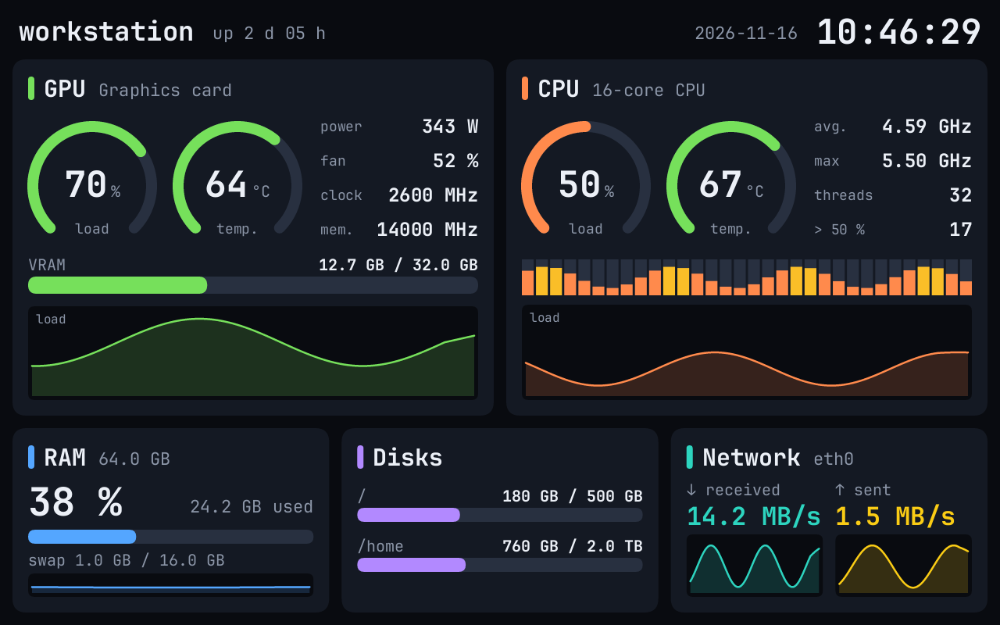
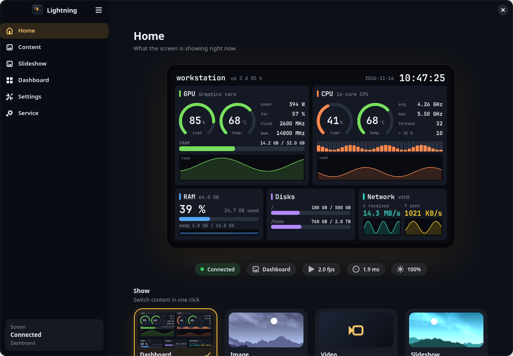
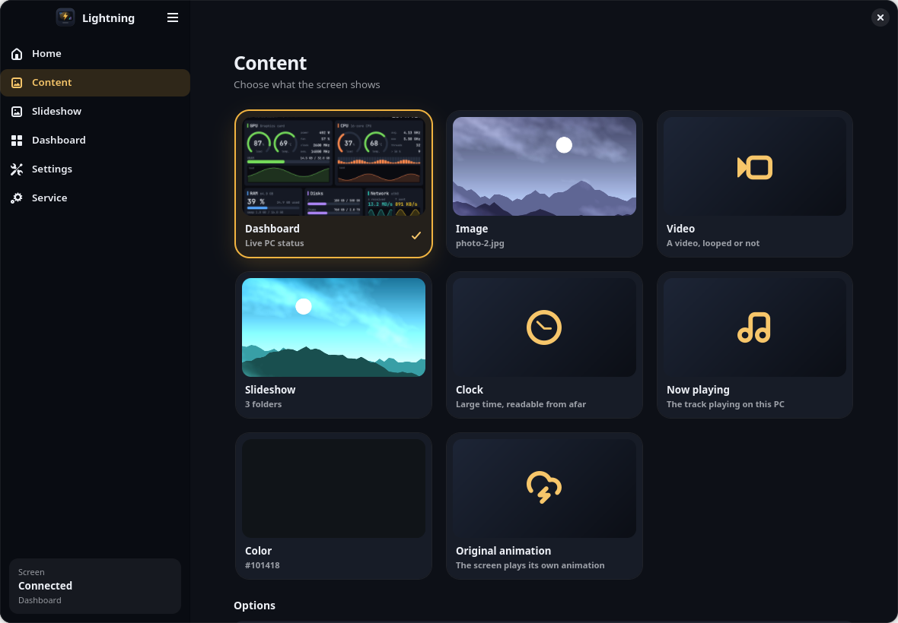
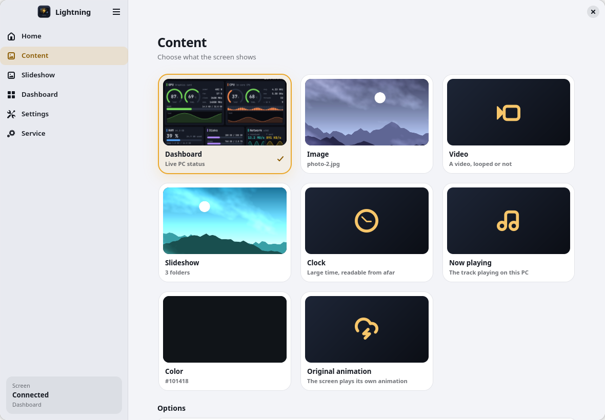
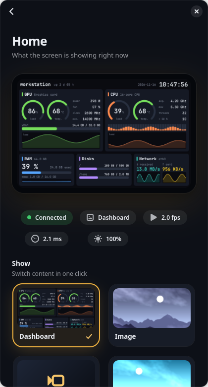
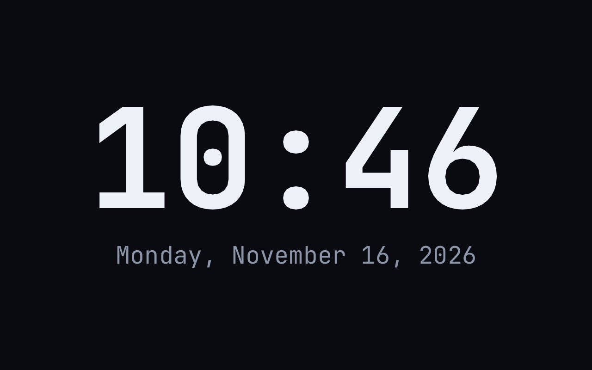
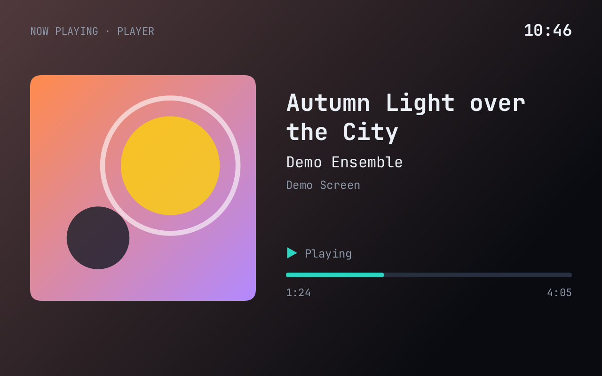

# lightning-lcd

*English · [Français](README.fr.md)*

Linux application for the built-in LCD screen of the **MSI RTX 5090 Lightning Z**
("V530-9.6 Lightning", USB `0db0:7881`, 1280×800). It replaces the Windows MSI Lightning Hub
app: color, image, video, stream, and above all a **live PC status dashboard**.



A GNOME application, **Lightning**, sets everything up without the command line:



The protocol (reverse-engineered from the Windows driver and service) is described in
[docs/PROTOCOL.md](docs/PROTOCOL.md) (in French). The original Python implementation, used as a
reference, is kept in [legacy/python/](legacy/python/).

## Installation

### Prebuilt binaries

Each version published on the [Releases](https://github.com/wizops-cloud/lightning-lcd/releases)
page provides an x86_64 archive (glibc ≥ 2.39, GTK ≥ 4.14, libadwaita ≥ 1.5) and its SHA-256 sums:

```sh
sha256sum -c SHA256SUMS --ignore-missing
tar xf lightning-lcd-*-x86_64-linux.tar.gz && cd lightning-lcd-*-x86_64-linux
./install.sh            # ~/.local/bin, application, user service, udev rule (sudo)
./install.sh --help     # --prefix, --no-udev, --no-service, --uninstall
```

Releases are built by `.github/workflows/release.yml` for every `v*` tag and created as drafts:
they are only published after a human check.

### Fedora (RPM)

`packaging/rpm/lightning-lcd.spec` builds two packages: `lightning-lcd` (`lightning` binary, udev
rule, `lightning-dashboard.service` user service) and `lightning-lcd-settings` (the "Lightning"
application). Rust dependencies are vendored; the build runs offline.

```sh
sudo dnf install -y rpm-build cargo-rpm-macros rpmlint libusb1-devel systemd-devel \
    libX11-devel gtk4-devel libadwaita-devel desktop-file-utils dbus-daemon
packaging/rpm/build-srpm.sh --rpm          # SRPM + RPM in target/rpm-dist/
sudo dnf install target/rpm-dist/x86_64/lightning-lcd-{,settings-}0*.rpm
systemctl --user enable --now lightning-dashboard.service
```

**COPR**: build the SRPM (`packaging/rpm/build-srpm.sh`), then submit it to a COPR project, from
the web interface ("New Build" → "Upload") or with `copr-cli`:

```sh
sudo dnf install -y copr-cli          # API token in ~/.config/copr (copr.fedorainfracloud.org/api)
copr-cli create lightning-lcd --chroot fedora-43-x86_64 --chroot fedora-44-x86_64 \
    --description "LCD screen of the MSI RTX 5090 Lightning Z"
copr-cli build lightning-lcd target/rpm-dist/lightning-lcd-*.src.rpm
# On the user side:
sudo dnf copr enable <account>/lightning-lcd && sudo dnf install lightning-lcd lightning-lcd-settings
```

For a new version: update `Version`, `%changelog` and, if `Cargo.lock` changed, the `License`
line (summary printed by `%{cargo_license_summary}` during the build).

### Flatpak (application only)

`packaging/flatpak/cloud.wizops.Lightning.yml` packages the "Lightning" application (GNOME 51
runtime). The daemon, which talks to the screen over USB, stays installed on the system (RPM,
archive or sources): the application talks to it on the session bus
(`cloud.wizops.Lightning.Daemon`) and drives the service through `org.freedesktop.systemd1`. It
reads the home folder read-only (slideshow covers, real paths returned by the file chooser).

```sh
sudo dnf install -y flatpak-builder
flatpak remote-add --user --if-not-exists flathub https://dl.flathub.org/repo/flathub.flatpakrepo
flatpak-builder --user --install-deps-from=flathub --install --force-clean \
    build-flatpak packaging/flatpak/cloud.wizops.Lightning.yml
flatpak run cloud.wizops.Lightning
```

AppStream metadata lives in `packaging/cloud.wizops.Lightning.metainfo.xml`
(`appstreamcli validate --no-net`; screenshot URLs only answer once the repository is public).
When `Cargo.lock` changes, regenerate `packaging/flatpak/cargo-sources.json` with
`flatpak-cargo-generator.py` ([flatpak-builder-tools](https://github.com/flatpak/flatpak-builder-tools)).

### From source

Requirements:

| | Fedora | Debian / Ubuntu |
|---|---|---|
| Rust stable (2024 edition) | `rustup` | `rustup` |
| libusb | `libusb1-devel` | `libusb-1.0-0-dev` |
| Settings application (GTK ≥ 4.14, libadwaita ≥ 1.5) | `gtk4-devel libadwaita-devel` | `libgtk-4-dev libadwaita-1-dev` |
| Preview window | — | `libxkbcommon-dev libwayland-dev libx11-dev libx11-xcb-dev` |
| HEIC photos (optional, `--features heic`) | `libheif-devel` (+ `libheif-freeworld` or `libheif-ffmpeg` for HEVC) | `libheif-dev libheif-plugin-libde265` |
| At runtime | `ffmpeg` (video), NVIDIA driver (GPU panel) | same |

```sh
sudo dnf install -y libusb1-devel gtk4-devel libadwaita-devel ffmpeg
cargo build --release

# Binaries
install -Dm755 target/release/lightning ~/.local/bin/lightning
install -Dm755 target/release/lightning-settings ~/.local/bin/lightning-settings

# Screen access without root (USB + hidraw of screens 0db0:7880 to 0db0:7919)
sudo install -m644 packaging/70-lightning-lcd.rules /etc/udev/rules.d/
sudo rm -f /etc/udev/rules.d/70-msi-lightning-lcd.rules   # old name (0.1), if present
sudo udevadm control --reload-rules && sudo udevadm trigger --attr-match=idVendor=0db0 --attr-match=idProduct=7881

# User service (controllable daemon)
install -Dm644 packaging/lightning-dashboard.service ~/.config/systemd/user/lightning-dashboard.service
systemctl --user daemon-reload
systemctl --user enable --now lightning-dashboard.service

# Application in the GNOME menu
install -Dm644 packaging/cloud.wizops.Lightning.desktop ~/.local/share/applications/cloud.wizops.Lightning.desktop
install -Dm644 packaging/icons/cloud.wizops.Lightning.svg ~/.local/share/icons/hicolor/scalable/apps/cloud.wizops.Lightning.svg
install -Dm644 packaging/icons/cloud.wizops.Lightning-symbolic.svg ~/.local/share/icons/hicolor/symbolic/apps/cloud.wizops.Lightning-symbolic.svg
gtk4-update-icon-cache -q -t -f ~/.local/share/icons/hicolor
update-desktop-database ~/.local/share/applications
```

Without the settings application, `cargo build --release -p lightning` is enough and GTK is not
needed.

### Upgrading from 0.1

Runtime files no longer carry the manufacturer's brand:

| 0.1 | Now | Migration |
|---|---|---|
| `/etc/udev/rules.d/70-msi-lightning-lcd.rules` | `70-lightning-lcd.rules` | install the new rule and remove the old one (commands above; `install.sh` and the RPM do it) |
| `$XDG_RUNTIME_DIR/msi-lightning-lcd.lock` | `lightning-lcd.lock` | automatic: both locks are taken, a 0.1 still running stays excluded |
| `$XDG_RUNTIME_DIR/msi-lightning-lcd.auth` | `lightning-lcd.auth` | automatic: the old cache is read once, then replaced |

After upgrading, restart the service (`systemctl --user restart lightning-dashboard`).

HEIC phone photos: `cargo build --release -p lightning --features heic` (libheif ≥ 1.17 and an
HEVC decoder for libheif). Without this option, the slideshow skips `.heic` / `.heif` files.

## Language

The application, the `lightning ctl` messages and the texts drawn on the screen follow the session
language (`LANGUAGE`, `LC_ALL`, `LC_MESSAGES`, `LANG`): French for `fr_*` (and when no language is
set, e.g. `C`), English otherwise. To force one: `LANG=en_US.UTF-8 lightning-settings`; for the
daemon, set `Environment=LANG=…` in the user service.

Translations are PO files compiled into the binaries (`crates/lightning-i18n/po/`): nothing to
install in `/usr/share/locale`, no system dependency. The French source text is the key; a missing
translation falls back to French, and a test fails if a marked text has no English entry.

## Settings application

Start "Lightning" from the GNOME menu, or run `lightning-settings`. The application never touches
the hardware: it drives the daemon over D-Bus and the service through the systemd D-Bus API.

| Page | Contents |
|---|---|
| Home | large live preview of the screen, status chips (link, content, frame rate, render time, brightness), content cards, brightness |
| Content | illustrated cards (dashboard, image, video, slideshow, clock, now playing, color, original animation) and options of the selected content |
| Slideshow | folder tiles with cover and photo count, Google Photos import, playback settings |
| Dashboard | shown panels, order (drag and drop or up/down buttons) and layout diagram |
| Settings | brightness, orientation, frame rate, behavior on exit, HTTP preview |
| Service | status, start/stop, restart, start at login |

- Dark interface by default, following the system light style; the sidebar collapses into a
  single column when the window is narrow.
- The preview is decoded off the UI thread, at most twice per second, and paused while the
  window is hidden.
- If the service is stopped, a status page offers to start it.
- Main menu: "About" (F1), "Quit" (Ctrl+Q).

| Dark | Light | Narrow |
|---|---|---|
|  |  |  |

All screenshots: [docs/screenshots/en/](docs/screenshots/en/) (English) and
[docs/screenshots/](docs/screenshots/) (French). They are regenerated by `scripts/screenshots.sh`
(along with `docs/dashboard.png` and `docs/en/`): a `--no-lcd --demo` daemon and a fake systemd
manager on a private D-Bus bus, a `mutter --headless` compositor, demo photos drawn on the fly.
Neither the screen nor the real service is touched. It needs `mutter`, ImageMagick (`magick`) and
`python3-gobject` on top of the build dependencies.

## Daemon, D-Bus and `lightning ctl`

The service runs `lightning daemon`: a display loop whose settings can all be changed live and are
saved to `~/.config/lightning/config.toml`.

```sh
lightning ctl status
lightning ctl mode dashboard|image|video|slideshow|clock|now_playing|color|msi_animation
lightning ctl image photo.jpg --fit contain
lightning ctl video movie.mp4 [--once]
lightning ctl color ff8800
lightning ctl slideshow ~/Pictures --interval 20 --order chronological
lightning ctl next                       # next photo
lightning ctl clock [--seconds] [--no-date]          # full-screen clock
lightning ctl now-playing [--player spotify]         # current track (MPRIS)
lightning ctl brightness 60              # applied within a few seconds
lightning ctl fps 1 ; lightning ctl rotation 180 ; lightning ctl widgets cpu,gpu,network
lightning ctl on-exit blank ; lightning ctl http on --addr 127.0.0.1:7881
lightning ctl restore                    # gives the screen back to the MSI animation
lightning ctl frame preview.jpg          # last frame sent
lightning ctl google status|start|cancel|clear
```

D-Bus interface (session bus): name `cloud.wizops.Lightning.Daemon`, object
`/cloud/wizops/Lightning`, interface `cloud.wizops.Lightning1`.

- **Methods**: `SetMode`, `ShowImage`, `PlayVideo`, `ShowColor`, `Restore`, `SetBrightness`,
  `SetFps`, `SetRotation`, `SetWidgets`, `SetOnExit`, `SetHttp`, `SetSlideshow`, `SlideshowNext`,
  `SetClock`, `SetNowPlaying`,
  `SetGoogleCredentials`, `GooglePhotosStart`, `GooglePhotosCancel`, `GooglePhotosClearCache`,
  `GetFrameJpeg`, `SaveConfig`, `ReloadConfig`.
- **Properties** (read-only, with `PropertiesChanged`): `LcdState`, `LcdDetail`, `Mode`,
  `Brightness`, `FirmwareBrightness`, `Fps`, `Rotation`, `Widgets`, `AvailableWidgets`, `OnExit`,
  `HttpEnabled`, `HttpAddr`, `ImagePath`, `ImageFit`, `VideoPath`, `VideoLoop`, `Color`,
  `MeasuredFps`, `RenderMs`, `FramesSent`, `Slideshow*`, `ClockSeconds`, `ClockDate`,
  `NowPlayingPlayer`, `NowPlayingTitle`, `Google*`, `Version`.

```sh
busctl --user introspect cloud.wizops.Lightning.Daemon /cloud/wizops/Lightning
```

## Slideshow

The `slideshow` mode shows the photos of one or more folders (recursive; JPEG, PNG, WebP, BMP,
and HEIC / HEIF with the `heic` feature): duration per photo, random or chronological order (EXIF
capture date, otherwise file date), EXIF orientation honored, whole photo on a blurred background
or filled screen, crossfade, caption (date and folder name) and a small clock. The next photo is
decoded ahead of time in a thread; folders are rescanned every minute.

### Google Photos

Since March 31, 2025, the Google Photos Library API no longer gives access to the library
(`photoslibrary*` scopes removed). The official way is the **Picker API**: you pick the photos in
Google's interface and the application only sees those. They are copied to
`~/.cache/lightning/google-photos/`, which becomes a slideshow folder. Nothing is sent anywhere but
to Google.

You need to create your own OAuth client once:

1. [Google Cloud Console](https://console.cloud.google.com/) → create a project.
2. "APIs & Services" → "Library" → enable **Google Photos Picker API**.
3. "OAuth consent screen": type *External*, fill in the application name and your address, then
   add yourself as a *test user* (the application can stay in testing mode).
4. "Credentials" → "Create credentials" → "OAuth client ID" → type **Desktop app**. Note the
   client ID and secret.
5. In the application: Slideshow page → Google Photos → "OAuth credentials", or in `config.toml`:

   ```toml
   [google]
   client_id = "….apps.googleusercontent.com"
   client_secret = "…"
   ```

6. "Choose Google photos…": the browser opens for the authorization (only once), then on the Google
   Photos picker. Once the selection is confirmed, the photos are downloaded and the slideshow
   picks them up.

The refresh token is stored in the session keyring (Secret Service: GNOME Keyring, KeePassXC…),
item "Lightning : accès à Google Photos". When no keyring is reachable or it is locked (service
started outside a graphical session), it stays in `~/.config/lightning/google.json` (mode 0600); an
old file is moved into the keyring as soon as it answers. The token never appears in the logs.
"Clear cache" deletes the imported photos.

## Clock and now playing

- **Clock** (`clock`): the time in very large digits, readable from afar, with the full date;
  seconds are optional.
- **Now playing** (`now_playing`): title, artist, album, cover and progress of the track played by
  an MPRIS-compatible player (Spotify, Rhythmbox, Lollypop, browsers…). The daemon polls the session
  bus once per second; it picks the player that is playing, otherwise the paused one, or the
  preferred player (`[now_playing] player = "spotify"`). The cover is read from disk or downloaded
  from the address given by the player.

| Clock | Now playing |
|---|---|
|  |  |

## Command line

Direct commands drive the screen without the daemon (stop the service first: one process at a
time).

```sh
lightning status                 # firmware status (mode, brightness, versions)
lightning dashboard              # live dashboard (Ctrl-C to stop)
lightning dashboard --png f.png  # one dashboard capture, without touching the screen
lightning --demo dashboard --png f.png   # same with fake data (documentation screenshots)
lightning color ff8800           # solid color
lightning image photo.jpg [--fit cover|contain|stretch]
lightning video movie.mp4 [--fps 30] [--loop]
ffmpeg … -c:v mjpeg -huffman default -f mjpeg - | lightning stream
lightning brightness 80          # brightness 0-100
lightning restore                # gives the screen back to the firmware (MSI animation)
```

The first call can take 4 to 10 s: the firmware only reads its command channel about every 4 s.
`-v` / `-vv` show what is going on. Command-line help (`--help`) is in French.

### Remote preview (window and browser)

Each frame can go to several outputs at once with `--output` (`lcd` by default):

```sh
lightning --output lcd,window dashboard        # the screen + a preview window on the desktop
lightning --output lcd,http dashboard          # the screen + http://127.0.0.1:7881/
lightning --no-lcd --output window dashboard   # develop without touching the screen
lightning --output lcd,window,http video movie.mp4
```

- **`window`**: native window (Wayland or X11), scaled image, aspect ratio kept. A debug banner
  shows the actual frame rate, render and encode times, JPEG size and screen state (connected,
  reconnecting, absent…). Keys: `O` banner, `R` preview rotation (0/90/180/270°), `Q` or `Esc` to
  quit. Options: `--no-overlay`, `--preview-rotation 90`. Closing the window stops the program.
- **`http`**: read-only local server, `--http-addr 127.0.0.1:7881` by default (`0.0.0.0:7881` to
  watch from another device on the network — no authentication):

  | Path | Contents |
  |---|---|
  | `/` | page with the stream, the status and an orientation selector |
  | `/stream.mjpg` | MJPEG stream (`multipart/x-mixed-replace`) |
  | `/frame.jpg`, `/frame.png` | last frame (the PNG is lossless for the dashboard) |
  | `/status.json` | frame rate, render time, JPEG size, screen state |

A missing, unplugged or busy screen does not crash the other outputs: its state shows in the
banner and in `/status.json`, and the connection is retried continuously. With `color` or
`image`, a preview output keeps the program running until Ctrl-C.

### Exit and exclusivity

- `--on-exit keep` (default) leaves the last frame; `blank` shows a black "dashboard stopped"
  screen; `restore` gives control back to the firmware (original MSI animation).
  `lightning restore` does the same on demand.
- Only one process drives the screen at a time (lock `$XDG_RUNTIME_DIR/lightning-lcd.lock`): a
  second launch fails with a clear message instead of disturbing the first one.

### Configuration

Optional, in `~/.config/lightning/config.toml`; see
[packaging/config.example.toml](packaging/config.example.toml) (frame rate, JPEG quality,
rotation 0/180, brightness, shown panels, disks, network interface, outputs, HTTP address,
behavior on exit).

## Layout

| Path | Role |
|---|---|
| `crates/lightning-lcd` | Protocol only: "BY" HID frame, RSA authentication, bulk session, reconnection |
| `crates/lightning-dashboard` | Metrics collection (procfs, hwmon, NVML) and 1280×800 rendering |
| `crates/lightning` | `lightning` binary: direct commands, D-Bus daemon, `ctl`, slideshow, `lcd` / `window` / `http` outputs |
| `crates/lightning-ipc` | Shared D-Bus interface (names, zbus proxy) |
| `crates/lightning-i18n` | Translations (PO catalogs compiled in, language from the environment) |
| `crates/lightning-gtk` | GNOME application `lightning-settings` (GTK 4 + libadwaita) |
| `packaging/` | udev rule, systemd user service, `.desktop`, icon, configuration example, `install.sh`, RPM package (`rpm/`), Flatpak (`flatpak/`), AppStream |
| `docs/PROTOCOL.md` | Protocol and reverse-engineering history (French) |
| `legacy/` | Original Python scripts (historical reference) |

```rust
let mut display = lightning_lcd::Display::open()?;
display.show_rgb(&pixels)?; // 1280 × 800 × 3 bytes
```

## Compatible hardware

| USB ID | Card | Status |
|---|---|---|
| `0db0:7881` | MSI GeForce RTX 5090 Lightning Z | tested, used by default |
| `0db0:7880` to `0db0:7919` | other cards declared by the Windows driver | **untested**, only with `--any-supported-pid` |

By default, lightning only drives `0db0:7881`. To try another screen of the range, with the
service stopped: `lightning --any-supported-pid status`, then `color`, `dashboard`… (or
`any_supported_pid = true` in the `[output]` section of the configuration, for the daemon). The
ID in use shows in `lightning status` and in the daemon's screen state (`lightning ctl status`).
Please report the result with the "Retour sur un matériel non testé" issue template.

## Known limitations

- Uploading media to the screen's flash memory (`transport`) is deliberately not implemented.
- Rotation: 0 and 180° only (in software); the firmware `rotate` command is not used.
- Going back to the original MSI animation requires power-cycling the screen.

## Contributing

Build, tests, commit style and hardware safety rules: [CONTRIBUTING.md](CONTRIBUTING.md) (French).
Bugs and requests go through the
[issue templates](https://github.com/wizops-cloud/lightning-lcd/issues/new/choose); report a
vulnerability privately, see [SECURITY.md](SECURITY.md).

## License and disclaimers

Copyright © 2026 WizOps — [wizops.fr](https://wizops.fr).

This program is free software distributed under the **GNU General Public License, version 3**
(see [LICENSE](LICENSE)): you may use, study, modify and redistribute it, provided you publish
your changes under the same license. It comes with **no warranty**.

- **Independent project.** It is neither affiliated with nor endorsed by MSI or NVIDIA. Brand and
  product names are only used to identify compatible hardware and belong to their owners.
- **Interoperability.** The protocol was recovered by studying the hardware and its driver, on a
  retail unit, for the sole purpose of making it work on Linux. The repository contains no
  manufacturer code. The RSA key it contains is a public key.
- **At your own risk.** The screen sits on an expensive graphics card. The program only sends
  display and settings commands; writing to the screen's flash memory is deliberately not
  implemented.

The embedded font is JetBrains Mono (SIL Open Font License 1.1, see
`crates/lightning-dashboard/assets/OFL.txt`).
