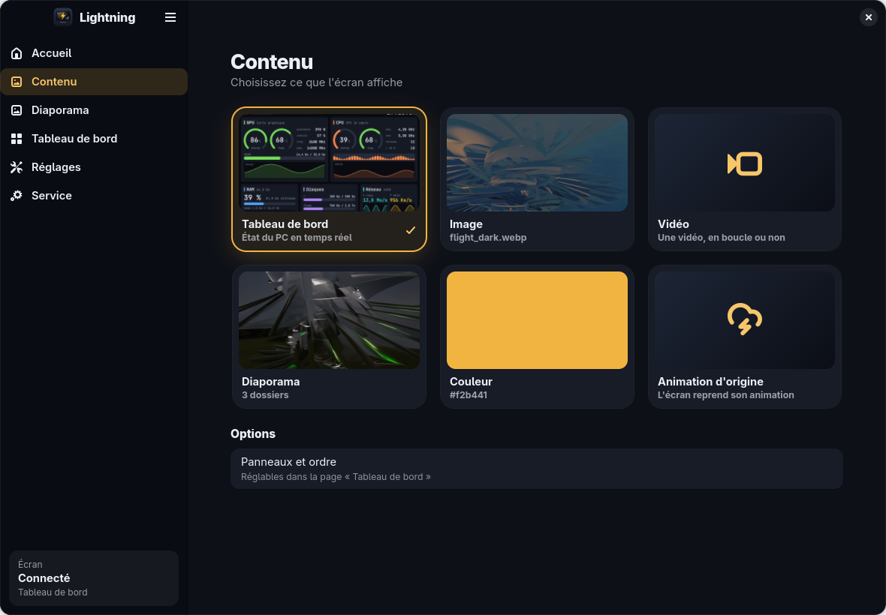
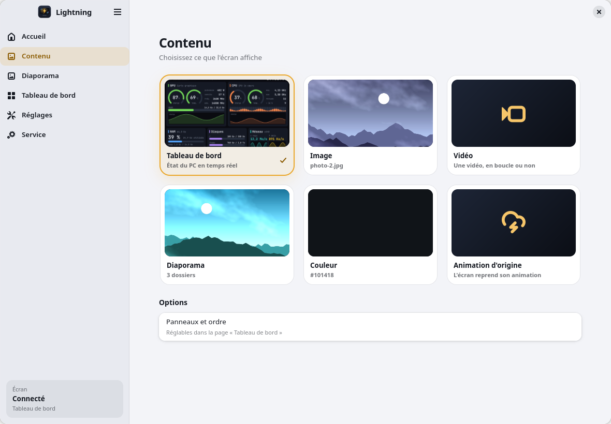
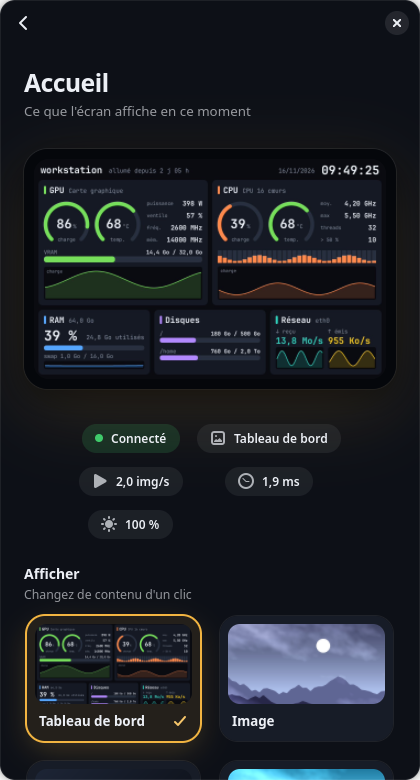
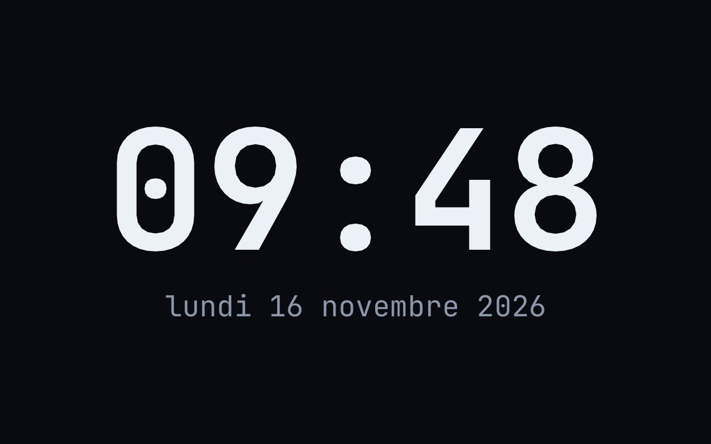
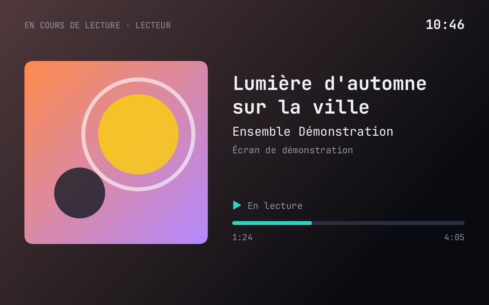

# lightning-lcd

Application Linux pour l'écran LCD intégré de la **MSI RTX 5090 Lightning Z**
(« V530-9.6 Lightning », USB `0db0:7881`, 1280×800). Elle remplace l'appli Windows
MSI Lightning Hub : couleur, image, vidéo, flux, et surtout un **tableau de bord de
l'état du PC** affiché en continu.


Une application GNOME, **Lightning**, règle le tout sans ligne de commande :


Le protocole (rétro-ingénierie du pilote et du service Windows) est décrit dans
[docs/PROTOCOL.md](docs/PROTOCOL.md). L'implémentation Python d'origine, qui a servi de
référence, est conservée dans [legacy/python/](legacy/python/).

## Installation

### Binaires précompilés

Chaque version publiée sur la page [Releases](https://github.com/wizops-cloud/lightning-lcd/releases)
fournit une archive x86_64 (glibc ≥ 2.39, GTK ≥ 4.14, libadwaita ≥ 1.5) et ses sommes SHA-256 :

```sh
sha256sum -c SHA256SUMS --ignore-missing
tar xf lightning-lcd-*-x86_64-linux.tar.gz && cd lightning-lcd-*-x86_64-linux
./install.sh            # ~/.local/bin, application, service utilisateur, règle udev (sudo)
./install.sh --help     # --prefix, --no-udev, --no-service, --uninstall
```

Les releases sont construites par `.github/workflows/release.yml` à chaque étiquette `v*` et
créées en brouillon : elles ne sont publiées qu'après vérification humaine.

### Fedora (RPM)

`packaging/rpm/lightning-lcd.spec` produit deux paquets : `lightning-lcd` (binaire `lightning`,
règle udev, service utilisateur `lightning-dashboard.service`) et `lightning-lcd-settings`
(application « Lightning »). Les dépendances Rust sont embarquées, la construction se fait hors
ligne.

```sh
sudo dnf install -y rpm-build cargo-rpm-macros rpmlint libusb1-devel systemd-devel \
    libX11-devel gtk4-devel libadwaita-devel desktop-file-utils dbus-daemon
packaging/rpm/build-srpm.sh --rpm          # SRPM + RPM dans target/rpm-dist/
sudo dnf install target/rpm-dist/x86_64/lightning-lcd-{,settings-}0*.rpm
systemctl --user enable --now lightning-dashboard.service
```

**COPR** : construire le SRPM (`packaging/rpm/build-srpm.sh`), puis le soumettre à un projet
COPR, depuis l'interface web (« New Build » → « Upload ») ou avec `copr-cli` :

```sh
sudo dnf install -y copr-cli          # jeton API dans ~/.config/copr (copr.fedorainfracloud.org/api)
copr-cli create lightning-lcd --chroot fedora-43-x86_64 --chroot fedora-44-x86_64 \
    --description "Écran LCD de la MSI RTX 5090 Lightning Z"
copr-cli build lightning-lcd target/rpm-dist/lightning-lcd-*.src.rpm
# Côté utilisateur :
sudo dnf copr enable <compte>/lightning-lcd && sudo dnf install lightning-lcd lightning-lcd-settings
```

Pour une nouvelle version : mettre à jour `Version`, `%changelog` et, si `Cargo.lock` a changé,
la ligne `License` (résumé affiché par `%{cargo_license_summary}` pendant la construction).

### Flatpak (application seule)

`packaging/flatpak/cloud.wizops.Lightning.yml` empaquette l'application « Lightning » (runtime
GNOME 51). Le démon, qui accède à l'écran en USB, reste installé sur le système (RPM, archive ou
sources) : l'application lui parle sur le bus de session (`cloud.wizops.Lightning.Daemon`) et
pilote le service par `org.freedesktop.systemd1`. Elle lit le dossier personnel en lecture seule
(couvertures du diaporama, vrais chemins renvoyés par le sélecteur de fichiers).

```sh
sudo dnf install -y flatpak-builder
flatpak remote-add --user --if-not-exists flathub https://dl.flathub.org/repo/flathub.flatpakrepo
flatpak-builder --user --install-deps-from=flathub --install --force-clean \
    build-flatpak packaging/flatpak/cloud.wizops.Lightning.yml
flatpak run cloud.wizops.Lightning
```

Les métadonnées AppStream sont dans `packaging/cloud.wizops.Lightning.metainfo.xml`
(`appstreamcli validate --no-net` ; les URL des captures ne répondent que si le dépôt est public).
Quand `Cargo.lock` change, régénérer `packaging/flatpak/cargo-sources.json` avec
`flatpak-cargo-generator.py` ([flatpak-builder-tools](https://github.com/flatpak/flatpak-builder-tools)).

### Depuis les sources

Prérequis :

| | Fedora | Debian / Ubuntu |
|---|---|---|
| Rust stable (édition 2024) | `rustup` | `rustup` |
| libusb | `libusb1-devel` | `libusb-1.0-0-dev` |
| Application de réglage (GTK ≥ 4.14, libadwaita ≥ 1.5) | `gtk4-devel libadwaita-devel` | `libgtk-4-dev libadwaita-1-dev` |
| Fenêtre d'aperçu | — | `libxkbcommon-dev libwayland-dev libx11-dev libx11-xcb-dev` |
| À l'exécution | `ffmpeg` (vidéo), pilote NVIDIA (panneau GPU) | idem |

```sh
sudo dnf install -y libusb1-devel gtk4-devel libadwaita-devel ffmpeg
cargo build --release

# Binaires
install -Dm755 target/release/lightning ~/.local/bin/lightning
install -Dm755 target/release/lightning-settings ~/.local/bin/lightning-settings

# Accès à l'écran sans root (USB + hidraw de 0db0:7881 uniquement)
sudo install -m644 packaging/70-msi-lightning-lcd.rules /etc/udev/rules.d/
sudo udevadm control --reload-rules && sudo udevadm trigger --attr-match=idVendor=0db0 --attr-match=idProduct=7881

# Service utilisateur (démon pilotable)
install -Dm644 packaging/lightning-dashboard.service ~/.config/systemd/user/lightning-dashboard.service
systemctl --user daemon-reload
systemctl --user enable --now lightning-dashboard.service

# Application dans le menu GNOME
install -Dm644 packaging/cloud.wizops.Lightning.desktop ~/.local/share/applications/cloud.wizops.Lightning.desktop
install -Dm644 packaging/icons/cloud.wizops.Lightning.svg ~/.local/share/icons/hicolor/scalable/apps/cloud.wizops.Lightning.svg
install -Dm644 packaging/icons/cloud.wizops.Lightning-symbolic.svg ~/.local/share/icons/hicolor/symbolic/apps/cloud.wizops.Lightning-symbolic.svg
gtk4-update-icon-cache -q -t -f ~/.local/share/icons/hicolor
update-desktop-database ~/.local/share/applications
```

Sans l'application de réglage : `cargo build --release -p lightning` suffit, et GTK n'est pas requis.

## Application de réglage

Lancer « Lightning » depuis le menu GNOME, ou `lightning-settings`. L'application ne touche pas
au matériel : elle pilote le démon par D-Bus et le service par l'API D-Bus de systemd.

| Page | Contenu |
|---|---|
| Accueil | grand aperçu en direct de l'écran, pastilles d'état (liaison, contenu, cadence, temps de rendu, luminosité), cartes de contenu, luminosité |
| Contenu | cartes illustrées (tableau de bord, image, vidéo, diaporama, horloge, lecture en cours, couleur, animation d'origine) et options du contenu choisi |
| Diaporama | tuiles des dossiers avec couverture et nombre de photos, import Google Photos, réglages de lecture |
| Tableau de bord | panneaux affichés, ordre (glisser-déposer ou boutons monter/descendre) et schéma de la disposition |
| Réglages | luminosité, orientation, cadence, comportement à l'arrêt, aperçu HTTP |
| Service | état, marche/arrêt, redémarrage, lancement à l'ouverture de session |

- Interface sombre par défaut, qui suit le thème clair du système ; navigation latérale qui se
  replie en une colonne quand la fenêtre est étroite.
- L'aperçu est décodé hors du fil de l'interface, deux fois par seconde au plus, et mis en pause
  quand la fenêtre est masquée.
- Si le service est arrêté, un écran d'état propose de le démarrer.
- Menu principal : « À propos » (F1), « Quitter » (Ctrl+Q).

| Sombre | Clair | Étroit |
|---|---|---|
|  |  |  |

Toutes les captures : [docs/screenshots/](docs/screenshots/). Elles se régénèrent avec
`scripts/screenshots.sh` (avec `docs/dashboard.png`) : démon `--no-lcd --demo` et faux
gestionnaire systemd sur un bus D-Bus privé, compositeur `mutter --headless`, photos de
démonstration dessinées à la volée. Ni l'écran ni le service réel ne sont touchés. Il faut
`mutter`, ImageMagick (`magick`) et `python3-gobject` en plus des dépendances de construction.

## Démon, D-Bus et `lightning ctl`

Le service lance `lightning daemon` : une boucle d'affichage dont tous les réglages se changent à
chaud et sont enregistrés dans `~/.config/lightning/config.toml`.

```sh
lightning ctl status
lightning ctl mode dashboard|image|video|slideshow|clock|now_playing|color|msi_animation
lightning ctl image photo.jpg --fit contain
lightning ctl video film.mp4 [--once]
lightning ctl color ff8800
lightning ctl slideshow ~/Images --interval 20 --order chronological
lightning ctl next                       # photo suivante
lightning ctl clock [--seconds] [--no-date]          # horloge plein écran
lightning ctl now-playing [--player spotify]         # morceau en cours (MPRIS)
lightning ctl brightness 60              # appliquée en quelques secondes
lightning ctl fps 1 ; lightning ctl rotation 180 ; lightning ctl widgets cpu,gpu,network
lightning ctl on-exit blank ; lightning ctl http on --addr 127.0.0.1:7881
lightning ctl restore                    # rend l'écran à l'animation MSI
lightning ctl frame apercu.jpg           # dernière image diffusée
lightning ctl google status|start|cancel|clear
```

Interface D-Bus (bus de session) : nom `cloud.wizops.Lightning.Daemon`, objet
`/cloud/wizops/Lightning`, interface `cloud.wizops.Lightning1`.

- **Méthodes** : `SetMode`, `ShowImage`, `PlayVideo`, `ShowColor`, `Restore`, `SetBrightness`,
  `SetFps`, `SetRotation`, `SetWidgets`, `SetOnExit`, `SetHttp`, `SetSlideshow`, `SlideshowNext`,
  `SetClock`, `SetNowPlaying`,
  `SetGoogleCredentials`, `GooglePhotosStart`, `GooglePhotosCancel`, `GooglePhotosClearCache`,
  `GetFrameJpeg`, `SaveConfig`, `ReloadConfig`.
- **Propriétés** (lecture seule, avec `PropertiesChanged`) : `LcdState`, `LcdDetail`, `Mode`,
  `Brightness`, `FirmwareBrightness`, `Fps`, `Rotation`, `Widgets`, `AvailableWidgets`, `OnExit`,
  `HttpEnabled`, `HttpAddr`, `ImagePath`, `ImageFit`, `VideoPath`, `VideoLoop`, `Color`,
  `MeasuredFps`, `RenderMs`, `FramesSent`, `Slideshow*`, `ClockSeconds`, `ClockDate`,
  `NowPlayingPlayer`, `NowPlayingTitle`, `Google*`, `Version`.

```sh
busctl --user introspect cloud.wizops.Lightning.Daemon /cloud/wizops/Lightning
```

## Diaporama

Le mode `slideshow` affiche les photos d'un ou plusieurs dossiers (récursif ; JPEG, PNG, WebP,
BMP — le HEIC n'est pas décodé) : durée par photo, ordre aléatoire ou chronologique (date de prise
de vue EXIF, sinon date du fichier), orientation EXIF respectée, photo entière sur fond flou ou
écran rempli, fondu enchaîné, légende (date et nom du dossier) et petite horloge. La photo suivante
est décodée à l'avance dans un fil ; les dossiers sont relus toutes les minutes.

### Photos Google

Depuis le 31 mars 2025, la Library API de Google Photos ne donne plus accès à la bibliothèque
(portées `photoslibrary*` supprimées). La voie officielle est la **Picker API** : vous choisissez
les photos dans l'interface de Google, l'application ne voit que celles-là. Elles sont copiées dans
`~/.cache/lightning/google-photos/`, qui devient un dossier du diaporama. Rien n'est envoyé ailleurs
que chez Google.

Il faut créer une fois votre propre client OAuth :

1. [Google Cloud Console](https://console.cloud.google.com/) → créer un projet.
2. « API et services » → « Bibliothèque » → activer **Google Photos Picker API**.
3. « Écran de consentement OAuth » : type *Externe*, renseigner le nom de l'application et votre
   adresse, puis vous ajouter comme *utilisateur test* (l'application peut rester en mode test).
4. « Identifiants » → « Créer des identifiants » → « ID client OAuth » → type **Application de
   bureau**. Noter l'identifiant client et le secret.
5. Dans l'application : page Diaporama → Google Photos → « Identifiants OAuth », ou dans
   `config.toml` :

   ```toml
   [google]
   client_id = "….apps.googleusercontent.com"
   client_secret = "…"
   ```

6. « Choisir des photos Google… » : le navigateur s'ouvre pour l'autorisation (une seule fois),
   puis sur le sélecteur de Google Photos. Une fois la sélection validée, les photos sont
   téléchargées et le diaporama les prend en compte.

Le jeton de rafraîchissement est conservé dans `~/.config/lightning/google.json` (mode 0600).
« Vider le cache » supprime les photos importées.

## Horloge et lecture en cours

- **Horloge** (`clock`) : l'heure en très grand, lisible de loin, avec la date en toutes lettres ;
  secondes facultatives.
- **En cours de lecture** (`now_playing`) : titre, artiste, album, pochette et progression du
  morceau joué par un lecteur compatible MPRIS (Spotify, Rhythmbox, Lollypop, navigateurs…). Le
  démon interroge le bus de session une fois par seconde ; il choisit le lecteur qui joue, sinon
  celui en pause, ou le lecteur préféré (`[now_playing] player = "spotify"`). La pochette est lue
  sur le disque ou téléchargée depuis l'adresse fournie par le lecteur.

| Horloge | En cours de lecture |
|---|---|
|  |  |

## Usage en ligne de commande

Les commandes directes pilotent l'écran sans démon (arrêter le service avant : un seul processus
à la fois).

```sh
lightning status                 # état du firmware (mode, luminosité, versions)
lightning dashboard              # tableau de bord en continu (Ctrl-C pour arrêter)
lightning dashboard --png f.png  # une capture du tableau de bord, sans toucher à l'écran
lightning --demo dashboard --png f.png   # idem avec des données factices (captures de la documentation)
lightning color ff8800           # couleur unie
lightning image photo.jpg [--fit cover|contain|stretch]
lightning video film.mp4 [--fps 30] [--loop]
ffmpeg … -c:v mjpeg -huffman default -f mjpeg - | lightning stream
lightning brightness 80          # luminosité 0-100
lightning restore                # rend l'écran au firmware (animation MSI)
```

Le premier appel peut prendre 4 à 10 s : le firmware ne lit son canal de commande
qu'une fois toutes les ~4 s. `-v` / `-vv` détaillent ce qui se passe.

### Aperçu déporté (fenêtre et navigateur)

Chaque image produite peut partir vers plusieurs sorties à la fois avec `--output`
(`lcd` par défaut) :

```sh
lightning --output lcd,window dashboard        # l'écran + une fenêtre d'aperçu sur le bureau
lightning --output lcd,http dashboard          # l'écran + http://127.0.0.1:7881/
lightning --no-lcd --output window dashboard   # développer sans toucher à l'écran
lightning --output lcd,window,http video film.mp4
```

- **`window`** : fenêtre native (Wayland ou X11), image à l'échelle, proportions conservées.
  Un bandeau de debug indique la cadence réelle, les temps de rendu et d'encodage, la taille du
  JPEG et l'état de l'écran (connecté, reconnexion, absent…). Touches : `O` bandeau, `R` rotation
  de l'aperçu (0/90/180/270°), `Q` ou `Échap` pour quitter. Options : `--no-overlay`,
  `--preview-rotation 90`. Fermer la fenêtre arrête le programme.
- **`http`** : serveur local en lecture seule, `--http-addr 127.0.0.1:7881` par défaut
  (`0.0.0.0:7881` pour regarder depuis un autre appareil du réseau — sans authentification) :

  | Chemin | Contenu |
  |---|---|
  | `/` | page avec le flux, l'état et un sélecteur d'orientation |
  | `/stream.mjpg` | flux MJPEG (`multipart/x-mixed-replace`) |
  | `/frame.jpg`, `/frame.png` | dernière image (le PNG est sans perte pour le tableau de bord) |
  | `/status.json` | cadence, temps de rendu, taille JPEG, état de l'écran |

L'écran absent, débranché ou déjà utilisé ne fait pas planter les autres sorties : son état
apparaît dans le bandeau et dans `/status.json`, et la connexion est retentée en continu.
Avec `color` ou `image`, une sortie d'aperçu maintient le programme ouvert jusqu'à Ctrl-C.

### Arrêt et exclusivité

- `--on-exit keep` (défaut) laisse la dernière image ; `blank` affiche un écran noir
  « tableau de bord arrêté » ; `restore` rend la main au firmware (animation MSI d'origine).
  `lightning restore` fait la même chose à la demande.
- Un seul processus pilote l'écran à la fois (verrou `$XDG_RUNTIME_DIR/msi-lightning-lcd.lock`) :
  un second lancement échoue avec un message clair au lieu de perturber le premier.

### Configuration

Facultative, dans `~/.config/lightning/config.toml` ; voir
[packaging/config.example.toml](packaging/config.example.toml) (cadence, qualité JPEG,
rotation 0/180, luminosité, panneaux affichés, disques, interface réseau, sorties,
adresse HTTP, comportement à l'arrêt).

## Organisation

| Chemin | Rôle |
|---|---|
| `crates/lightning-lcd` | Protocole seul : trame HID « BY », authentification RSA, session bulk, reconnexion |
| `crates/lightning-dashboard` | Collecte des métriques (procfs, hwmon, NVML) et rendu 1280×800 |
| `crates/lightning` | Binaire `lightning` : commandes directes, démon D-Bus, `ctl`, diaporama, sorties `lcd` / `window` / `http` |
| `crates/lightning-ipc` | Interface D-Bus partagée (noms, proxy zbus) |
| `crates/lightning-gtk` | Application GNOME `lightning-settings` (GTK 4 + libadwaita) |
| `packaging/` | Règle udev, service systemd utilisateur, `.desktop`, icône, exemple de configuration, `install.sh`, paquet RPM (`rpm/`), Flatpak (`flatpak/`), AppStream |
| `docs/PROTOCOL.md` | Protocole et historique de la rétro-ingénierie |
| `legacy/` | Scripts Python d'origine (référence historique) |

```rust
let mut display = lightning_lcd::Display::open()?;
display.show_rgb(&pixels)?; // 1280 × 800 × 3 octets
```

## Limites connues

- L'upload de médias dans la flash de l'écran (`transport`) n'est volontairement pas implémenté.
- Rotation : 0 et 180° seulement (logicielle) ; la commande `rotate` du firmware n'est pas utilisée.
- Le retour à l'animation MSI d'origine demande de couper l'alimentation de l'écran.

## Contribuer

Construction, tests, style des commits et règles de sécurité du matériel :
[CONTRIBUTING.md](CONTRIBUTING.md). Les bogues et demandes passent par les
[modèles d'issue](https://github.com/wizops-cloud/lightning-lcd/issues/new/choose) ; une
vulnérabilité se signale en privé, voir [SECURITY.md](SECURITY.md).

## Licence et avertissements

Copyright © 2026 WizOps — [wizops.fr](https://wizops.fr).

Ce programme est un logiciel libre distribué sous la **GNU General Public License, version 3**
(voir [LICENSE](LICENSE)) : vous pouvez l'utiliser, l'étudier, le modifier et le redistribuer, à
condition de publier vos modifications sous la même licence. Il est fourni **sans aucune
garantie**.

- **Projet indépendant.** Il n'est ni affilié à MSI ou à NVIDIA, ni approuvé par eux. Les noms de
  marques et de produits ne sont cités que pour désigner le matériel compatible et appartiennent à
  leurs propriétaires.
- **Interopérabilité.** Le protocole a été retrouvé par l'étude du matériel et de son pilote, sur
  un exemplaire acheté dans le commerce, dans le seul but de le faire fonctionner sous Linux. Le
  dépôt ne contient aucun code du constructeur. La clé RSA qui y figure est une clé publique.
- **À vos risques.** L'écran équipe une carte graphique coûteuse. Le programme n'envoie que des
  commandes d'affichage et de réglage ; l'écriture dans la mémoire flash de l'écran n'est
  volontairement pas implémentée.

La police embarquée est JetBrains Mono (SIL Open Font License 1.1, voir
`crates/lightning-dashboard/assets/OFL.txt`).
